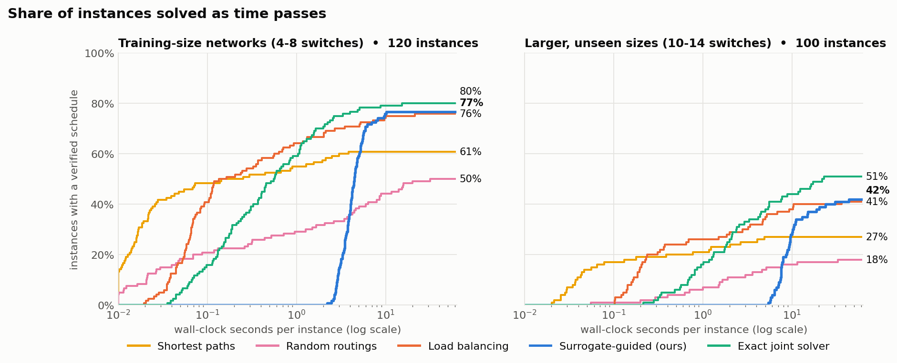
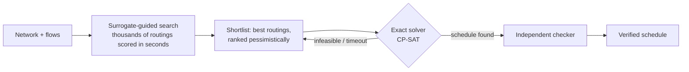
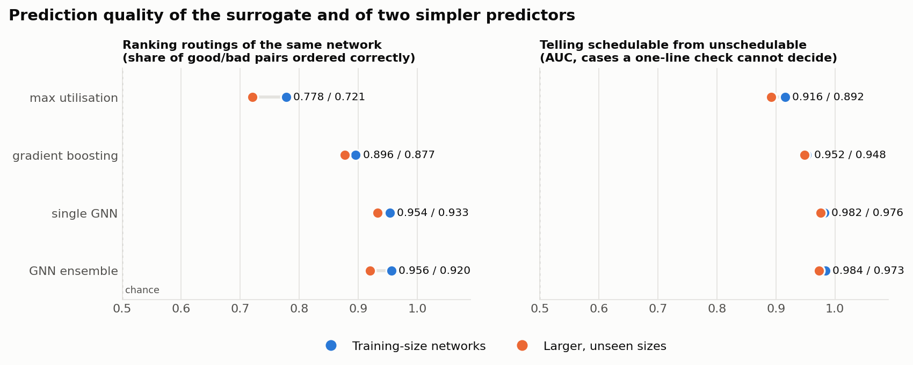
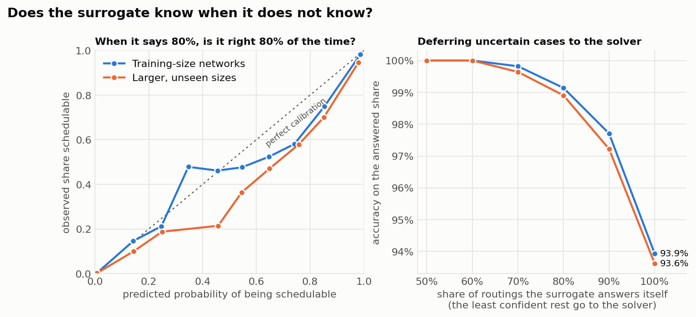
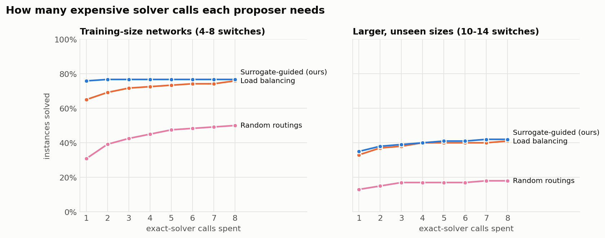
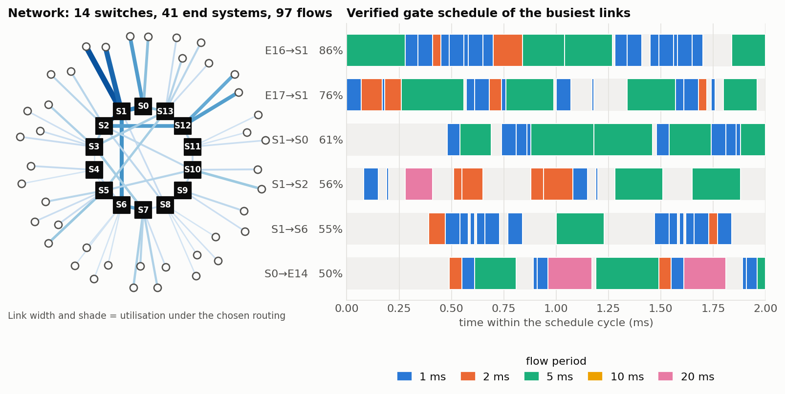

# tsn-scout

**Predict, then verify: a learned surrogate that scouts routings for time-triggered Ethernet (IEEE 802.1Qbv) schedule synthesis, with every answer checked by an exact solver.**

**Status: a negative result, reported as measured.** The surrogate predicts schedulability
well and keeps doing so on networks twice the size it was trained on. Used to steer the
routing search, it does **not** solve more instances than a simple load-balancing
heuristic (42 vs 41 of 100 large networks, 92 vs 91 of 120 small ones), and an exact joint
routing-and-scheduling solver beats both (51 and 96). Measurable gains are small: fewer
solver calls on training-size networks, and a non-significant edge (46 vs 41) when each
solver call is given 20 s instead of 5 s. The sections below give the numbers and the reason.



## The problem

A time-sensitive network carries periodic flows whose frames must cross every switch at
precomputed instants. Finding those instants (the *gate schedule*) is a constraint
problem: two frames may never occupy the same link at the same time, hops must follow each
other in order, and each flow has an end-to-end deadline.

Whether a schedule exists depends on the **routing**: which path each flow takes. A
designer exploring routings has to ask an exact solver about each one, and near the edge
of feasibility one question costs seconds, sometimes without an answer. The alternative,
handing routing and scheduling to the solver as one problem, is exact but scales badly.

This repository asks one question: **can a cheap learned predictor decide which routings
are worth the solver's time, without ever being trusted with the final answer?**

## The idea



1. **Exact oracle.** A CP-SAT model of offset-based 802.1Qbv scheduling
   ([`solver.py`](src/tsnscout/solver.py)). It is the ground truth for training labels and
   the judge of every result.
2. **Surrogate.** A message-passing network on the bipartite flow-link graph
   ([`gnn.py`](src/tsnscout/gnn.py), plain PyTorch, no graph library) predicts whether a
   routing is schedulable within the solver's time limit. Five independently initialised
   copies form an ensemble; their disagreement is the uncertainty.
3. **Search.** Simulated annealing over routings, steered by the surrogate
   ([`search.py`](src/tsnscout/search.py)). Routings are ranked by *mean minus one standard
   deviation* of the ensemble, so a routing ranks high only if every member likes it.
4. **Verification.** The shortlist goes to the exact solver in order. A schedule is
   reported only after a separate brute-force checker ([`checker.py`](src/tsnscout/checker.py))
   confirms it. **A wrong prediction can cost time; it cannot produce a wrong schedule.**

## Results

Everything below comes from one run on an Apple M1 laptop (8 cores, six benchmark processes
side by side). The raw records behind every number are in [`results/`](results).

### 1. The surrogate is a good predictor, also on larger networks

Trained on 10,200 solver-labelled routings of networks with 4-8 switches and 20-60 flows.
Tested on 1,600 unseen routings of the same size (54% schedulable, 15% solver timeouts) and
on 800 routings of networks with 10-14 switches and 50-110 flows, a size it never saw
(26% schedulable, 22.5% timeouts).

| Predictor | Ranking, same size | Ranking, larger | AUC, same size | AUC, larger | ECE, same size | ECE, larger |
|---|---|---|---|---|---|---|
| Highest link utilisation | 0.778 | 0.721 | 0.916 | 0.892 | 0.031 | 0.086 |
| Gradient boosting, 13 hand-made features | 0.896 | 0.877 | 0.952 | 0.948 | 0.039 | 0.041 |
| One GNN | 0.954 | **0.933** | 0.982 | **0.976** | 0.019 | **0.028** |
| Ensemble of five GNNs | **0.956** | 0.920 | **0.984** | 0.973 | **0.016** | 0.031 |

*Ranking*: among routings of the same network, the share of (schedulable, unschedulable)
pairs put in the right order; this is what a search needs. *AUC*: computed only on routings
that a one-line utilisation or GCD check cannot already reject. *ECE*: expected calibration
error after temperature scaling, lower is better.



- The gap to the hand-made baselines is largest on ranking, the hardest of the three tasks.
- Going to networks about twice as large costs the GNN two to four points of ranking
  accuracy, not more.
- **The ensemble does not pay for itself on larger networks**: a single member ranks better
  there (0.933 vs 0.920). It helps slightly at training size only.
- Speed: 2.7 ms per routing (6.2 ms on large networks) against a solver mean of 1.07 s
  (1.47 s). The solver's *median* is only 45 ms (70 ms): half of all routings are easy for
  it, so the speed-up matters only on the hard half.
- The second output head, the solver's run time, reaches a rank correlation of 0.88 (0.86)
  with the measured time.



When the surrogate says more than 90%, it is right 98.3% of the time at training size and
94.5% on larger networks. If it answers only the 80% of routings it is most sure about and
leaves the rest to the solver, its accuracy on the answered share is 99.1% (98.9%).

### 2. Steering the search with it does not solve more instances

Each proposing method may spend eight solver calls of 5 s on an instance. The joint solver
gets one call of 60 s. Instances are new: 120 at training size, 100 larger.

| Method | Solved, small (of 120) | on the first call | Solved, large (of 100) | on the first call | Mean seconds per instance, small / large |
|---|---|---|---|---|---|
| Shortest paths | 73 | 73 | 27 | 27 | 0.7 / 1.1 |
| Random routings | 60 | 37 | 18 | 13 | 6.4 / 8.8 |
| Load balancing | 91 | 78 | 41 | 33 | 2.3 / 7.8 |
| **Surrogate-guided** | 92 | **91** | 42 | 35 | 6.0 / 18.0 |
| Exact joint solver | **96** | 96 | **51** | 51 | 9.2 / 24.8 |

- **Solved instances: no difference.** 92 vs 91 and 42 vs 41 are one instance apart. On the
  large set the guided search solves three instances load balancing misses and misses two
  that load balancing solves.
- **The joint solver dominates.** Every instance solved by any method was also solved by the
  joint solver, usually faster (median 0.35 s and 2.0 s on the instances it solves). It
  proved 9 small and 16 large instances infeasible, which no proposing method can do.
- **What the surrogate does buy: fewer solver calls at training size.** Its first proposal
  is schedulable on 91 of 120 instances; the first load-balanced routing on 78 (14 instances
  won, 1 lost; exact sign test p = 0.001). One guided call equals eight load-balancing calls.
- **That gain does not transfer to larger networks** (35 vs 33 on the first call; 7 won,
  5 lost), **and it is not free.** About 3,800 surrogate evaluations take 4.0 s (8.5 s on large
  networks), more than the solver time it saves. In wall-clock terms load balancing reaches
  the same count sooner, as the figure at the top shows.



### 3. Why: the verifier's time limit is the bottleneck, not the ranking

**The guided search moves failures from "infeasible" to "undecided".** On the large set,
load balancing's failed solver calls are mostly proofs of infeasibility (152 infeasible, 126
timeouts). The surrogate's are mostly timeouts (91 infeasible, 158 timeouts). It has learnt
to avoid routings that are provably bad, and ends up in the region where the solver cannot
decide in 5 s either way.

**The routings that work are ones the surrogate was trained to reject.** I re-ran the nine
large instances that only the joint solver solved and gave the joint solver's own routing to
the fixed-routing solver. In eight of nine it could not schedule that routing in 5 s. A
schedule exists, the joint solver had just found it, but the fixed-routing model does not
find it in the time allowed. The surrogate's label is "schedulable within 5 s", so it scored
six of those eight routings below 0.10 (median 0.03). By its own definition it was right, and
that definition is the wrong target for the goal. In the ninth case the routing was
schedulable in 1.5 s and the surrogate gave it 0.04: a plain miss.

**It is overconfident on the largest networks.** On two of those nine instances (87 and 110
flows) its eight proposals had predicted probabilities between 0.60 and 0.99, and all
sixteen timed out.

**Longer solver calls help the guided search a little.** After seeing the result above I
re-ran the large set with the same 40 s of solver time per instance, split differently.
This follow-up was chosen after the main experiment and uses the same 100 instances, so it
is exploratory.

| Solver budget per instance | Load balancing | Surrogate-guided | Guided won / lost |
|---|---|---|---|
| 8 calls of 5 s (main experiment) | 41 | 42 | 3 / 2 |
| 2 calls of 20 s | 41 | 46 | 5 / 0 (sign test p = 0.06) |
| 1 call of 40 s | 41 | 45 | 6 / 2 (p = 0.29) |

Load balancing gains nothing from longer calls. The guided search gains three to four
instances, and with either split it solves one instance (71 flows) that the joint solver
left undecided after 60 s. The direction fits the explanation above: the routings the
surrogate prefers are schedulable but slow to schedule. The size of the effect, four or five
instances in a hundred, is not statistically significant, and the joint solver's 51 is
still ahead.

### 4. The active-learning round made no measurable difference

I expected the search to exploit the surrogate's optimistic mistakes, and one round of
labelling the search's own proposals (1,400 routings of 350 new networks) to correct that.
The data do not support it.

| | Validation AUC | Large set, solved | on the first call |
|---|---|---|---|
| Trained on the initial data | 0.9913 | 42 | 37 |
| After one active round | 0.9910 | 42 | 35 |

In the active round itself 70% of the proposals were schedulable, 19% infeasible and 11%
timeouts. Exploitation was not what held the search back.

### 5. What I take from this

1. Predicting feasibility is the easy part. A GNN on the flow-link graph does it well,
   transfers to larger networks, and is 240-400 times faster than the solver on average.
2. A good predictor is not automatically a useful search guide. Here its target ("the
   solver finishes in 5 s") cut out exactly the routings that mattered, and its proposal
   time was larger than the solver time it saved.
3. Where the exact joint solver finishes, it is the method to use. The surrogate would have
   to earn its place on instances the joint solver cannot finish. On this benchmark there
   are 33 such large instances. No proposing method solved any of them in the main
   experiment, and the guided search solved one in the follow-up. That is not evidence.

What I would try next, none of it tested here: label with a much longer solver limit, or
predict the time-to-solution directly and optimise that; give the surrogate's proposal to the
joint solver as a hint instead of fixing the routing; and benchmark at sizes where the joint
solver no longer finishes.

### Limits of this evidence

- One training run and one benchmark run; no confidence intervals beyond the paired counts
  given above. Differences of one or two instances mean nothing.
- Time limits were enforced while six processes shared the machine, so a "5 s timeout" is
  somewhat less than 5 s of undisturbed solving. All methods ran under the same load.
- The budget-split comparison in section 3 was run after the main result was known.
- Synthetic networks and a simplified scheduling model (next section).
- I did not test a search guided by the gradient-boosting baseline. Given the result above
  there is no reason to expect it to do worse than the GNN at solving instances.

## What is and is not modelled

The scheduling model follows the offset formulation of Craciunas et al. (RTNS 2016),
simplified:

| Modelled | Not modelled |
|---|---|
| Periodic time-triggered flows; periods 1, 2, 5, 10, 20 ms | Queue assignment and frame isolation between queues |
| One transmission window per flow per period, repeated on every hop | Clock synchronisation error and guard bands |
| Link exclusivity over the full hyperperiod | Best-effort and AVB traffic, frame preemption |
| Hop order with a fixed forwarding delay | Per-device processing-time variation |
| End-to-end deadline, at most 20% above the minimum latency of the longest candidate route | Redundant (802.1CB) streams |
| Up to four loop-free candidate routes per flow | Topology synthesis |

Networks are synthetic: a ring of switches with random chords, one to four end systems per
switch, and uneven traffic between zones. Link speed and frame sizes are abstracted into
window lengths in 10 µs ticks. No data from a real vehicle is used.

**Solver timeouts.** The exact solver is given 5 s per routing. Routings it cannot decide
in that time are labelled *not schedulable*, on the grounds that a routing the solver
cannot schedule in the time available is of no use to a designer. The share of such cases
is reported with the results; all of them are counted against whichever method proposed them.

## Reproducing the results

```bash
python -m venv .venv && source .venv/bin/activate
pip install -e ".[dev]"
pytest                                             # 21 tests, about 30 s

python scripts/make_dataset.py --split val         # label data with the exact solver
python scripts/make_dataset.py --split train
python scripts/make_dataset.py --split test
python scripts/make_dataset.py --split test_large

python scripts/train.py --train data/train.jsonl --val data/val.jsonl --out models/scout_round0.pt
python scripts/active_round.py --model models/scout_round0.pt --out data/active1.jsonl
python scripts/train.py --train data/train.jsonl data/active1.jsonl --val data/val.jsonl --out models/scout.pt

python scripts/evaluate_prediction.py --model models/scout.pt
python scripts/run_search.py --config small --n 120 --model scout=models/scout.pt
python scripts/run_search.py --config large --n 100 --model scout=models/scout.pt --model round0=models/scout_round0.pt
python scripts/make_figures.py

# follow-up: same solver budget, longer calls
python scripts/run_search.py --config large --n 100 --k 2 --time-limit 20 --methods balanced scout:scout \
    --model scout=models/scout.pt --out results/search_large_2x20.json
python scripts/run_search.py --config large --n 100 --k 1 --time-limit 40 --methods balanced scout:scout \
    --model scout=models/scout.pt --out results/search_large_1x40.json
```

Everything is seeded. Instance seeds are disjoint across training, validation, test,
active-learning and search-benchmark sets. The trained ensemble is committed
(`models/scout.pt`), so the demo runs without retraining:

```bash
tsnscout demo --config large --seed 5000057 --plot example.png
```

```
instance 5000057 (large): 14 switches, 41 end systems, 130 directed links, 97 flows

surrogate's opinion before any solving:
  shortest paths  P(schedulable) = 84.4%   ensemble disagreement = 0.47
  load balancing  P(schedulable) = 54.3%   ensemble disagreement = 0.77

method                       verified schedule  solver calls   seconds
shortest paths               no                            1      5.00
load balancing               no                            8     40.14
surrogate-guided             yes                           1      8.57
```

This seed is one of the three large instances where the guided search succeeds and load
balancing does not; it is shown because it produces a schedule to plot, not because it is
typical. Note that the surrogate also gave shortest paths 84%, and the solver timed out on
them. Timings vary with the machine, so a run elsewhere may differ.



## Why the tests matter here

The solver is the ground truth of the whole project, so a silent modelling error would
invalidate every number above. It is therefore checked three ways
([`tests/test_solver.py`](tests/test_solver.py)):

- **Against an independent checker** that paints every frame instance of the hyperperiod
  onto a timeline and counts overlaps, sharing no logic with the solver.
- **Against a second formulation.** Link exclusivity is stated once with modular
  arithmetic (two periodic windows of periods `Ti`, `Tj` never collide iff
  `(φj − φi) mod gcd(Ti, Tj) ∈ [Li, gcd − Lj]`) and once with interval variables over the
  hyperperiod. The two must return the same verdict on every instance.
- **On cases solved by hand**, including a three-flow conflict that no pairwise test reveals.

The surrogate is tested for the properties it should have by construction: its output does
not depend on the order of flows, nor on what else is in the batch.

## Repository layout

```
src/tsnscout/
  problem.py     network, flows, routes; cheap sound infeasibility checks
  generator.py   random zonal networks and traffic
  solver.py      CP-SAT schedule synthesis (fixed routing and joint routing + scheduling)
  checker.py     independent brute-force schedule validator
  baselines.py   load-balancing routing heuristic
  dataset.py     labelling instances with the solver
  features.py    graph encoding; vectorised for thousands of routings per second
  gnn.py         message-passing network and ensemble
  train.py       training, temperature scaling, calibration metrics
  search.py      proposal methods and the verify loop
  viz.py         figure style and the schedule plot
scripts/         dataset, training, evaluation, benchmark and figure scripts
tests/           21 tests
results/         raw numbers behind every figure
```

## Related work

- S. S. Craciunas, R. Serna Oliver, M. Chmelík, W. Steiner. *Scheduling Real-Time
  Communication in IEEE 802.1Qbv Time Sensitive Networks.* RTNS 2016. The scheduling model
  used here.
- F. Dürr, N. G. Nayak. *No-wait Packet Scheduling for IEEE Time-sensitive Networks.* RTNS 2016.
- P. Pop, M. L. Raagaard, S. S. Craciunas, W. Steiner. *Design optimisation of cyber-physical
  distributed systems using IEEE time-sensitive networks.* IET Cyber-Physical Systems, 2016.
  Routing and scheduling as a joint design problem.
- T. L. Mai, N. Navet, J. Migge. *On the use of supervised machine learning for assessing
  schedulability: application to Ethernet TSN.* RTNS 2019; and T. L. Mai, N. Navet.
  *Deep Learning to Predict the Feasibility of Priority-Based Ethernet Network
  Configurations.* ACM TCPS, 2021. Learning to predict TSN feasibility is their idea, not
  mine. This repository differs in using the predictor to *drive a search* whose results
  are verified exactly, and in reporting that on this benchmark doing so does not beat
  load balancing.
- B. Lakshminarayanan, A. Pritzel, C. Blundell. *Simple and Scalable Predictive Uncertainty
  Estimation using Deep Ensembles.* NeurIPS 2017.
- C. Guo, G. Pleiss, Y. Sun, K. Q. Weinberger. *On Calibration of Modern Neural Networks.* ICML 2017.

## Acknowledgement

Developed with the assistance of an AI coding assistant (Claude Code).

## License

MIT
